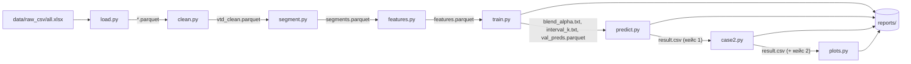

# PipeTwin: гид по проекту для команды

Этот документ для тех, кто знает Python, но код ещё не читал. Подробные таблицы экспериментов лежат в `README.md`
и `reports/experiments.csv`, здесь только суть.

## 1. Что делает проект

Трубопровод режем на сегменты по 10 м. Для каждого сегмента прогнозируем **минимальную остаточную толщину стенки** (мм),
которую покажет внутритрубная диагностика (ВТД) на дату T. Учитываем только внутренние дефекты.
Задача состоит из двух кейсов. Кейс 1: участок 1250022871 (DIR-2), есть прошлые ВТД, прогноз на 2023-12-01.
Кейс 2: участок 1250009583 (DIR-3), ВТД на нём не было ни разу, прогноз от ввода в эксплуатацию до 2023-08-12.
Оба прогноза пишутся в один файл `result.csv` (`id,segment_id,thickness_pred`, 525 + 1475 = 2000 строк).
Жюри считает r² по каждому кейсу, поэтому главное правильно **упорядочить** сегменты от тонких к толстым, а абсолютный уровень вторичен.

## 2. Архитектура



Все пути и константы берутся из `src/config.py`. Каждый шаг запускается как отдельный скрипт и общается
со следующим через файлы в `data/cache/`, `result.csv` и `reports/`.

**`main.py`.** Запускает по порядку `load → clean → segment → features → train → predict → case2 → plots`
(через `runpy`, как будто вы сами запустили каждый `src/<шаг>.py`). Вход: ничего. Выход: всё, что пишут шаги.
Полный прогон занимает около 15 с.

**`src/config.py`.** Только константы: пути (`ROOT`, `RAW_XLSX`, `CACHE`, `REPORTS`), даты (`T_DATE`, `T_DATE_CASE2`,
даты ввода и ВТД), id участков (`TARGET_IDS`, `CASE1_IDS`, `CASE2_ID`, `DIR3_IDS`), номиналы (`WT_NOM = 8.0`,
`WT_NOM_CASE2 = 4.5`, `WT_NOM_DIR3 = 6.0`), `SEG_LEN = 10`, `SEED = 42` и сдвиг прогонов `RUN_SHIFT_M`.

**`src/load.py`.** Вход: `all.xlsx` (6 листов, 18 МБ). Выход: `data/cache/<лист>.parquet`.
`load_all()` один раз читает Excel через calamine и кладёт каждый лист в parquet. `load(name)` во всём остальном
коде читает лист из кэша. Excel напрямую больше нигде не открываем.

**`src/clean.py`.** Вход: `vtd.parquet`. Выход: `vtd_clean.parquet`. `clean_vtd(ids, wt_nom)` оставляет только
потерю металла (в 2018 году тип дефекта лежит в `Feature Description`), выбрасывает `is_beyond_pot`, переводит глубину
2018 года из долей в проценты, заполняет пустую остаточную толщину как `номинал · (1 − глубина/100)` и оставляет
только внутренние дефекты. Та же функция используется в кейсе 2 для участков DIR-3.

**`src/segment.py`.** Вход: `vtd_clean.parquet` и лист profile (длины участков). Выход: `segments.parquet`.
`segment_grid(ids)` строит сетку `segment_id = 0 .. floor(L/10)`. `build_segments(shift_m, keep_date)` раскладывает
дефекты по сегментам и для каждой пары (участок, дата прогона) считает `min_thk`, `max_depth`, `n_defects` и `censored`.
При `shift_m > 0` дистанции всех прогонов, кроме `keep_date`, сдвигаются на `shift_m` метров (так делаем +8 м).

**`src/features.py`.** Вход: `segments.parquet`, profile, regime. Выход: `features.parquet`.
Одна строка означает «сегмент × переход ВТД_prev → ВТД_next» (2018→2022, 2022→2023, а для 22871 ещё 2022→T).
`prev_block()` даёт состояние на прошлом прогоне (`thk_prev`, глубина, число дефектов, соседи ±2 сегмента),
`relief_features()` даёт рельеф (`z_mean`, `slope`, `z_above_min100`, `is_local_min`), `regime_window()` даёт средние
режима между датами (только до T). Колонка `is_predict = 1` отмечает строки, где факта нет и нужен прогноз.

**`src/train.py`.** Вход: `features.parquet`. Выход: `reports/metrics.csv`, `reports/importance.csv`, а в кэш
`blend_alpha.txt`, `interval_k.txt` и `val_preds.parquet`. Сравнивает persistence, линейную экстраполяцию, Ridge и CatBoost
на трёх схемах валидации (временная, GroupKFold, LOSO). Ключевые функции: `fit_catboost` (учит потерю толщины
`thk_prev − thk_next`), `loso` (выбирает вес смеси α), `predict_interval`, `band` и `calibrate_k` (интервалы),
`r2` (квадрат корреляции Пирсона).

**`src/predict.py`.** Вход: `features.parquet`, `blend_alpha.txt`, `interval_k.txt`. Выход: `result.csv` (только кейс 1),
`reports/intervals.csv`, `reports/top10_dangerous.csv`. Учит CatBoost на всех размеченных переходах, смешивает
с persistence по α (сейчас α = 1, то есть чистый persistence), строит p10/p90 и проверяет формат через `assert`.

**`src/case2.py`.** Вход: кэш VTD, profile и regime для DIR-2, DIR-3 и 1250009583. Выход: дописывает строки 1250009583
в `result.csv`, `intervals.csv`, `top10_dangerous.csv` (по 10 % на трубу) и `metrics.csv` (строки `case2_*`), пишет
`reports/importance_case2.csv`. Ключевые функции: `train_target()` (скорость коррозии на DIR-2), `dir3_target()`
(то же для DIR-3), `terrain()` и `features()` (рельеф и режим за всю жизнь, один код для обучения и прогноза),
`validate()` (GroupKFold и перенос между трубами), `predict()` (скорость → толщина, масштаб уровня, квантили),
`write()` (дописывает файлы).

**`src/plots.py`.** Вход: `val_preds.parquet`, `reports/intervals.csv`. Выход: `reports/validation_scatter.png`
(прогноз против факта 2023) и `reports/profile_<id>.png` для обеих труб (прогноз с полосой p10–p90 вдоль трубы).

**`tests/test_result.py`.** Вход: `result.csv`. Проверяет колонки, отсутствие NaN и дублей, полный набор сегментов
для обеих труб (525 и 1475), диапазон `0 < толщина ≤ номинал` и точку как десятичный разделитель.
Если `result.csv` нет, тесты пропускаются.

## 3. Что лежит в `data/cache/`

| файл | содержимое |
|---|---|
| `profile.parquet`, `passport.parquet`, `regime.parquet`, `uzt.parquet`, `vtd.parquet`, `sample_result.parquet` | листы `all.xlsx` как есть, без изменений (пишет `load.py`) |
| `vtd_clean.parquet` | очищенные дефекты кейса 1: `id, date, Distance, Defect Type, depth_pct, rwt, Angle, …`; только внутренняя потеря металла |
| `segments.parquet` | сетка сегментов × прогон ВТД для трёх участков DIR-2: `min_thk`, `max_depth`, `n_defects`, `censored` (без сдвига) |
| `features.parquet` | строки «сегмент × переход» с признаками, целью `thk_next`, `transition` и флагом `is_predict` |
| `val_preds.parquet` | прогнозы на временной валидации 2022→2023 (persistence и CatBoost) для графика |
| `blend_alpha.txt` | выбранный вес смеси α (сейчас `1.0`) |
| `interval_k.txt` | коэффициент расширения интервалов кейса 1 (сейчас `1.5`) |

Кейс 2 ничего в кэш не пишет: он заново собирает свои таблицы из `vtd.parquet`, `profile.parquet` и `regime.parquet`.
Если кэш удалить, `load.py` пересоздаст его из Excel (около 3 с).

## 4. Ключевые решения и почему

**Кейс 1: persistence со сдвигом +8 м.** Прогноз на 2023 равен толщине из ВТД 2022 в том же сегменте. Координаты
прогона 2022 смещены относительно 2023 примерно на 8 м, поэтому перед разбиением на сегменты дистанции 2022 сдвигаем на +8 м.
Проверка на участках 9490 и 11604, где ВТД 2023 есть (55 сегментов): r² без сдвига 0.17, со сдвигом −1 сегмент 0.598,
со сдвигом +8 м 0.624. Сдвиг выбран перебором d = 0..10 м, пик ровно на 8. Поскольку точный сдвиг не известен,
итоговая `thk_prev` усредняется по сдвигам 6–10 м с шагом 0.5 (`RUN_SHIFT_AVG_M`): r² 0.624 → 0.627.
Пробовали также вычитать среднюю потерю c ≈ 0.34 мм: r² от этого не меняется, а честный LOSO MAE ухудшается (0.352 → 0.381), поэтому не вычитаем.

**Почему не CatBoost.** CatBoost предсказывает потерю толщины. На leave-one-section-out он даёт r² 0.416, а смеси
с persistence 0.50–0.60. Чистый persistence даёт 0.627 и выигрывает, поэтому α = 1. CatBoost оставлен для интервалов
и важности признаков. Причина простая: ранжирование почти целиком определяется прошлой толщиной, а модель потерь,
обученная на 55 сегментах, добавляет шум.

**Только внутренние дефекты.** Это подсказка ментора: метрика ВТД считается по внутренним. Внешних потерь металла
всего 153 из 34 094. На r² persistence фильтр не влияет (0.624), в `result.csv` изменился 21 сегмент.

**Сегменты без дефектов = номинал (censored).** ВТД 2022/2023 записывает только дефекты глубже 10 %, поэтому «нет дефекта»
значит «тоньше порога не нашли», а не «стенка идеальна». Такому сегменту ставим номинальную толщину (8.0 мм)
и флаг `censored = 1`, чтобы модель знала, что это нижняя граница, а не точный замер.

**Кейс 2: модель скорости коррозии.** На 1250009583 ВТД нет, учиться на нём нельзя. Учимся на DIR-2: от ввода
(2000-04-22) до ВТД 2022-07-06 (22.2 года), цель `rate = (8.0 − min_thk) / возраст`, мм/год (средняя 0.075, censored → 0).
Признаки описывают только рельеф (`z_rank`, уклон, превышение над локальным минимумом на 100 и 500 м, низкие точки).
Режим одинаков на всю трубу и далёк от обучающего, поэтому он используется только для уровня s, а не в модели. Модель: CatBoost (depth 4, 300 итераций, seed 42). Прогноз:
`толщина = 4.5 − s · rate_pred · 30.14 года`. r² на GroupKFold DIR-2 0.074, перенос на другую трубу около 0,
поэтому ожидаем на кейсе 2 низкий r², это нормально.

**Масштаб уровня под DIR-3 (s = 0.0342).** DIR-2 почти вся в воде (обводнённость 88 %), а у 1250009583 0.12 %, как у DIR-3.
Без поправки средняя толщина вышла бы 2.14 мм, что неправдоподобно. Поэтому `s = средняя скорость DIR-3 / средняя DIR-2 =
0.00258 / 0.07537`. Итог: средняя толщина 4.42 мм (4.37–4.48). Множитель один на все сегменты, поэтому r² и порядок
сегментов не меняются. Из-за узкого разброса `result.csv` пишется с 6 знаками после запятой.

**DIR-3 не добавляем в обучение.** У DIR-3 96 % сегментов без дефектов, r² на самой DIR-3 около 0, перенос между трубами около 0.

**Калибровка интервалов p10/p90.** Квантильный CatBoost (α = 0.1 и 0.9) даёт слишком узкую полосу: на валидации
она накрывает факт только в 60 % случаев вместо 80 %. Расширяем полосу вокруг p50 в k раз и, если итоговый прогноз
выходит за полосу, дотягиваем её до него. Кейс 1: k = 1.5, покрытие 0.82. Кейс 2: k = 1.4, покрытие 0.70 → 0.81.

## 5. Глоссарий

- **ВТД** (внутритрубная диагностика): прибор проходит внутри трубы и пишет дефекты с дистанцией, глубиной и остаточной толщиной. Это наш «факт».
- **УЗТ** (ультразвуковая толщинометрия): точечные ручные замеры толщины. В данных явно завышены (12–16 мм на трубе 8 мм), поэтому не используем.
- **Сегмент**: 10-метровый кусок участка, `segment_id = floor(дистанция / 10)`. Единица прогноза.
- **Persistence**: прогноз «будет так же, как в прошлый раз», то есть толщина из предыдущего ВТД.
- **Censored**: сегмент, где ВТД не нашла дефектов глубже порога. Настоящая толщина неизвестна, ставим номинал.
- **r²**: квадрат корреляции Пирсона между прогнозом и фактом. Не меняется от сдвига и масштаба, важен только порядок и форма.
- **GroupKFold**: кросс-валидация, где в тест уходят целые блоки по 500 м, чтобы соседние сегменты не попадали одновременно в обучение и тест.
- **LOSO** (leave-one-section-out): обучаемся на всех участках, кроме одного, тестируем на отложенном. Ближе всего к реальной задаче кейса 1.
- **p10/p90**: нижняя и верхняя границы интервала. Ожидаем, что факт окажется ниже p10 в 10 % случаев и выше p90 в 10 % случаев.

## 6. Как что-то поменять

**Даты, id, сдвиг, номинал.** Всё в `src/config.py`:
- дата прогноза: `T_DATE` (кейс 1), `T_DATE_CASE2` (кейс 2);
- участки: `TARGET_IDS` (что пишем в result для кейса 1), `CASE1_IDS` (обучение кейса 1), `CASE2_ID`, `DIR3_IDS`;
- сдвиг прогонов: `RUN_SHIFT_M = {("2022-07-06", "2023-12-01"): 8.0}` и сетка усреднения `RUN_SHIFT_AVG_M` (6–10 м). Ключ — пара дат (прошлый прогон, целевой). Если меняете `T_DATE`, обновите ключи в обоих словарях, иначе сдвиг не применится;
- номинал: `WT_NOM` (DIR-2), `WT_NOM_CASE2`, `WT_NOM_DIR3`; даты ввода: `COMMISSION_CASE1`, `COMMISSION_CASE2`, `COMMISSION_DIR3`.

**Добавить признак в кейс 1.**
1. Посчитать колонку в `src/features.py`: рельефный признак в `relief_features()`, признак прошлого прогона в `prev_block()`, режимный в `regime_window()` (или добавить колонку в `REGIME_COLS`).
2. Добавить её имя в список `FEATURES` в `src/train.py`.
3. Перезапустить и сравнить r² в `reports/metrics.csv`; записать строку в `reports/experiments.csv`.

Учтите, что сейчас в `result.csv` кейса 1 идёт persistence (α = 1), так что новый признак меняет только CatBoost, интервалы
и важность. До `result.csv` он дойдёт, только если LOSO выберет α < 1.

**Добавить признак в кейс 2.** Посчитать его в `terrain()` (рельеф) или `regime_life()` (режим) в `src/case2.py`
и дописать имя в `TERRAIN` или `REGIME_C2`. Итоговая модель (`FINAL = "catboost_terrain"`) берёт только `TERRAIN`; режимные признаки участвуют лишь в сравнительных моделях `*_all`. Код признаков общий для обучения и прогноза, поэтому больше ничего менять не нужно.

**Перезапуск и тесты.**
```bash
uv sync                      # один раз, ставит зависимости
uv run python main.py        # весь пайплайн, около 15 с
uv run python src/case2.py   # только кейс 2 (нужны result.csv и reports/ от кейса 1)
uv run pytest -q             # проверка result.csv
```
Отдельный шаг можно запустить как `uv run python src/<шаг>.py`, но он читает кэш предыдущих шагов: после правки
`clean.py` перезапускайте всё через `main.py`. Новую библиотеку ставьте через `uv add <пакет>`, потом обновите
`requirements.txt` командой `uv pip compile pyproject.toml -o requirements.txt` (его требует жюри).

## 7. Вероятные вопросы жюри

1. **Почему у вас в кейсе 1 нет ML, а просто прошлая толщина?** Проверили честно: на leave-one-section-out persistence даёт r² 0.627, CatBoost 0.416, смеси между ними. Коррозия за 1.4 года мала по сравнению с разбросом между сегментами, поэтому прошлая толщина и есть лучший ранжировщик. CatBoost используем для интервалов и анализа факторов.
2. **Откуда сдвиг +8 м и не подогнан ли он?** Прогоны разных лет по-разному привязаны по дистанции. Перебрали 0–10 м, пик на 8 м совпал с независимой оценкой сдвига. Подбор шёл на тех же 55 сегментах, поэтому прирост (0.598 → 0.624) слегка оптимистичен, но без выравнивания r² всего 0.17. Чтобы не зависеть от одного значения, усредняем толщину по сдвигам 6–10 м (0.627).
3. **Как вы прогнозируете трубу без единого ВТД (кейс 2)?** Учим скорость коррозии от рельефа на DIR-2 (от ввода до ВТД), переносим на 1250009583 и вычитаем из номинала скорость × 30.14 года. Сегменты одной трубы различаются только рельефом, потому что режим общий на весь участок.
4. **Почему ожидаемый r² кейса 2 такой низкий?** Внутри трубы есть только рельеф, а связь рельефа с коррозией слабая: r² 0.074 на DIR-2 и около 0 при переносе между трубами. Мы это не скрываем, приоритет был в полном и корректном `result.csv`.
5. **Зачем множитель 0.0342 и не портит ли он метрику?** Режим DIR-2 (88 % воды) далёк от 1250009583 (0.12 %), без поправки получилась бы стенка 2.1 мм из 4.5. Уровень берём с DIR-3 с похожей обводнённостью. Множитель положительный и общий, r² и порядок сегментов он не меняет.
6. **Почему номинал 4.5 мм, если УЗТ показывает 11–12 мм?** Берём паспорт. УЗТ и на DIR-2 систематически завышен (12.6–15.9 мм на трубе 8 мм), значит, это проблема данных УЗТ. На r² выбор номинала не влияет.
7. **Что делаете с сегментами без дефектов?** Ставим номинал и флаг censored: ВТД пишет только дефекты глубже 10 %, так что это нижняя граница потерь, а не точное значение.
8. **Насколько можно верить интервалам?** Сырые квантили CatBoost недооценивают неопределённость (покрытие 60–70 %), поэтому мы откалибровали расширение на валидации: 82 % в кейсе 1 и 81 % в кейсе 2 при цели 80 %.
